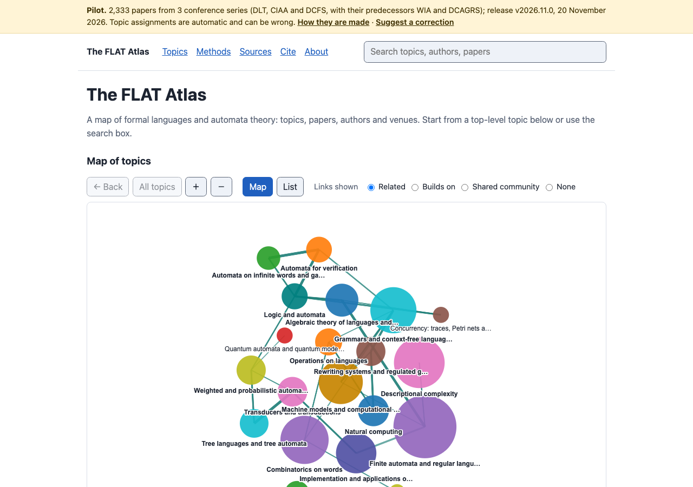

# The FLAT Atlas

An open, public map of **formal languages and automata theory** from the 1950s to today.

The Atlas links topics, papers, authors and venues so that researchers and students can:

- search a topic and see its papers, parent and child topics, related topics, key authors and activity over time;
- travel from general topics to specific ones, and sideways to related ones;
- see the whole field as a map;
- compare venues with transparent, side-by-side metrics.

**Live site:** <https://gmcmduarte.github.io/flat-atlas/> (a **pilot**: 2,333 papers from three conference series, DLT, CIAA and DCFS, with their predecessors WIA and DCAGRS; topic assignments are automatic and can be wrong, see the site's [Methods](https://gmcmduarte.github.io/flat-atlas/methods) page).



**Status:** the pilot pipeline and site exist; see [`docs/plan/PROGRESS.md`](docs/plan/PROGRESS.md) for where the project is.

## How it works

- Metadata comes from open sources: [DBLP](https://dblp.org), [OpenAlex](https://openalex.org), [Semantic Scholar](https://www.semanticscholar.org) and [Crossref](https://www.crossref.org). The Atlas stores metadata and links only, never full texts.
- The topic map and all topic tags are produced automatically, with a confidence score and the method that produced them.
- Everything is free to use and costs nothing to run.

## How the data is produced

1. **Harvest** metadata from DBLP (its XML dump), OpenAlex, Crossref and Semantic Scholar into a local cache, politely and resumably (`flatatlas harvest`).
2. **Resolve**: match the records of one paper across sources and merge conference and journal versions; identify authors and venues (`flatatlas resolve`).
3. **Tag**: a topic list reviewed by hand, then a program that scores every paper against every plausible topic from title words, similarity to example papers, OpenAlex hints and the titles of cited works, combined by a learned model and calibrated (`flatatlas tag`). Every tag stores a confidence and its provenance. Abstracts are read locally and never published.
4. **Aggregate and release**: topic sizes, links between topics (related, builds-on, shared-community) and the map layout (`flatatlas aggregate`), then a versioned, checked release folder (`flatatlas release build`).
5. **Export** the release as static JSON for the site (`flatatlas export static`); the site in `web/` is a static SvelteKit app. Publishing the real data to Pages is described in [`docs/runbooks/publish-site.md`](docs/runbooks/publish-site.md).

The method, its measured quality and its known limits are on the site's Methods page; the decisions behind them are in [`docs/plan/DECISIONS.md`](docs/plan/DECISIONS.md).

## Documentation

| Document | Content |
|---|---|
| [`docs/plan/PLAN.md`](docs/plan/PLAN.md) | Architecture, data model, taxonomy and tagging method |
| [`docs/plan/ROADMAP.md`](docs/plan/ROADMAP.md) | Phases and build sessions |
| [`docs/plan/DECISIONS.md`](docs/plan/DECISIONS.md) | Decision log |
| [`docs/plan/RISKS.md`](docs/plan/RISKS.md) | Risks and mitigations |

## Development

Needs [uv](https://docs.astral.sh/uv/); uv installs the pinned Python (3.12) by itself.

```bash
uv sync                      # create .venv and install the locked dependencies
uv run flatatlas --help      # the pipeline CLI
uv run pytest                # tests
uv run ruff check .          # lint
uv run ruff format .         # format
uvx pre-commit install       # once: run the hooks (ruff, gitleaks) on every commit
uvx pre-commit run --all-files
```

The site in `web/` needs Node 22.17 or newer (CI uses 24): `cd web && npm ci && npm run dev`; see `web/README.md`.

API keys go in `.env` (git-ignored); copy `.env.example` and fill it in. Never commit real values.

## Corrections

Found a wrong tag, a missing paper or a duplicated author? Every topic, paper, author and venue page on the site ends with a *Suggest a change* link that opens a pre-filled [issue form](.github/ISSUE_TEMPLATE/) here, or [open an issue](https://github.com/gmcmduarte/flat-atlas/issues/new/choose) directly. Issues are public.

## Citing

See [`CITATION.cff`](CITATION.cff) and the site's Cite page. Version v0.1.0 is archived on Zenodo: [doi:10.5281/zenodo.24461535](https://doi.org/10.5281/zenodo.24461535) (all versions: [doi:10.5281/zenodo.24461534](https://doi.org/10.5281/zenodo.24461534)). The archive holds the code and documentation, not the data files.

## Licence

Code: MIT (see [`LICENSE`](LICENSE)). Data releases: CC BY 4.0, with attribution to the sources. Details in `docs/plan/PLAN.md` §10.

## Maintainer

Guilherme Duarte.
