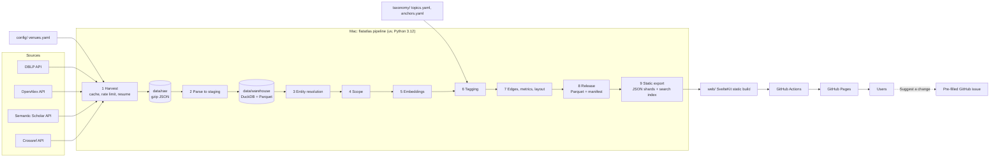
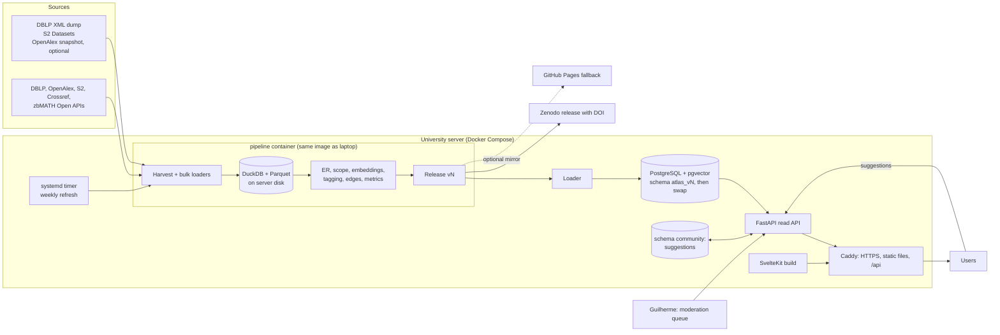

# The FLAT Atlas — Building Plan

Version 1.0, written 2026-11-15. Facts about external services were checked on that date.
Items marked **⚠ unverified** could not be confirmed and must be checked in the session that first uses them.

Contents: 1 Principles · 2 Architecture · 3 Sources · 4 Data model · 5 Pipeline · 6 Scope rule · 7 Venues · 8 Entity resolution · 9 Taxonomy and tagging · 10 Export and licences · 11 Frontend · 12 Backend · 13 Hosting and migration · 14 Server resources · 15 Feature designs · 16 Repo layout · 17 Unverified items

---

## 1. Principles

1. **One pipeline, two places.** The same Python package runs on the Mac and on the server. Only a *profile* (`pilot` or `server`) changes paths, batch sizes and which venues are active.
2. **The pipeline always computes in DuckDB + Parquet.** PostgreSQL is only a *serving* copy, loaded from an exported release. This removes the usual "rewrite for the database" step.
3. **A release is the contract.** The pipeline ends by writing a versioned *release* (a folder of Parquet files plus a manifest). The static site, the server database and the Zenodo dataset are all built from a release.
4. **Raw first.** Every API response is stored unmodified before parsing. Parsing can be re-run without touching the network.
5. **Everything automatic is labelled.** Tags, merges, scope decisions and edges carry `confidence` and `provenance`.
6. **Human input is small and explicit.** Only two folders are human-edited: `config/` (venues, settings) and `taxonomy/` (the reviewed topic DAG and anchor papers).
7. **Zero cost.** Free API tiers, free hosting, local models.

Laptop facts (measured): Apple M1, 16 GB RAM, about 22 GB free disk. The pilot must fit in **under 5 GB** of disk. No bulk snapshots on the laptop.

---

## 2. Architecture

### 2.1 Pilot stage (laptop + GitHub Pages)



### 2.2 Mass-import stage (university server)



### 2.3 Why this shape
- The static export and the Postgres loader read the **same release**, so the website shows the same data in both stages.
- The frontend talks to a small `DataSource` interface with two implementations: `StaticDataSource` (JSON files) and `ApiDataSource` (REST). Moving to the server changes one setting.
- If the server is late or disappears, the static path keeps working (see RISKS R7).

---

## 3. Sources

Checked on 2026-11-15. Re-check limits in the first session that uses each source and record changes in `docs/notes/sources.md`.

| Source | Role | Access and limits | Bulk option | Licence | Abstracts |
|---|---|---|---|---|---|
| **DBLP** | Backbone: venues, volumes, papers, author IDs (PIDs) | Open API, no key. Rate-limited: HTTP 429 with empty body when exceeded; exact numbers not published. Use ≤ 1 request/s and honour `Retry-After`. Also a public SPARQL endpoint (`sparql.dblp.org`). | `dblp.xml.gz` updated daily; monthly persistent releases since 2015; RDF dump (N-Triples/Turtle). About 1 GB compressed ⚠ size unverified. | **CC0 1.0** | None |
| **OpenAlex** | Citations, references, affiliations, countries, topics, keywords, abstracts (partial) | **Free API key required** since Feb 2026. Budget **$1/day free**, resets at midnight UTC. Single-record lookups (by ID or DOI) are free. List/filter calls cost $0.10 per 1,000 calls, so $1 buys 10,000 calls (1,000,000 works at `per_page=100`). Search costs $1 per 1,000 calls. New accounts are paced at $0.10 per 5 minutes at first. Rate limit ⚠ reported as 30 requests/s with key; treat as 10/s. | Free snapshot in S3 bucket `openalex` (`--no-sign-request`), JSONL or Parquet, **about 745 GB compressed**, refreshed **quarterly**. Daily snapshots are paid. | **CC0** | As `abstract_inverted_index`. Missing for many closed-access papers: Springer non-OA removed in 2022, Elsevier reduced since 2024 (secondary sources). |
| **Semantic Scholar** | SPECTER2 embeddings, citations with "influential" flag, abstracts (partial), TLDRs | Free API key on request; key gives **1 request/s** on all endpoints. Without key: shared anonymous pool, unreliable. `POST /paper/batch` takes many IDs per call (⚠ 500 per call, from memory). | Datasets API (key needed), release `2026-11-10` seen: `papers` (30×1.5 GB), `abstracts` (30×1.8 GB), `citations` (30×8.5 GB), `embeddings-specter_v2` (30×28 GB), `authors`, `tldrs`. Incremental diffs between releases ⚠ unverified. | Data **ODC-BY 1.0** (attribution; cite Kinney et al. 2023). Embeddings **Apache 2.0**. API licence requires "Semantic Scholar" attribution on the site. | In `abstracts` dataset and API; "selected papers" only. Redistribution of abstract text is not clearly granted. |
| **Crossref** | DOI metadata, reference lists, some abstracts, ISSN/ISBN, publication dates | No key. Polite pool by adding `mailto=`. Since 21 July 2026: polite = **10 requests/s single-record, 3 requests/s list queries**; public = 5 and 1. Limits are per email address. Read the `x-rate-limit-*` headers. | Annual public data file (2026 file released March 2026) ⚠ size unverified, larger than 200 GB. Not needed. | Metadata is treated as facts (no copyright claimed by Crossref); abstracts may be copyrighted by publishers. | Some, in JATS XML. |
| **zbMATH Open** (later phase) | Pre-1990 coverage, **MSC codes per paper**, reviews as extra signal | REST API and OAI-PMH; no numeric limit published; be slow (1 request/s). ⚠ Whether MSC codes are in the API payload is unverified (expected yes). | OAI-PMH harvesting of the open collection. | **CC BY-SA 4.0** (share-alike: see §10). | Reviews/summaries, partly restricted. |
| **CORE / ICORE ranks** | Venue rank | Portal `portal.core.edu.au/conf-ranks`. ICORE 2026 has been released. The portal blocked automated fetching (HTTP 403) during planning. | Manual CSV export from the portal ⚠ unverified. | No licence stated ⚠. Store rank + edition + source URL per venue only. | n/a |

**Consequences for the design**

- **The whole field fits in the free API tiers.** A field of an estimated 150,000–300,000 papers (⚠ estimate) needs about 3,000 OpenAlex list calls ($0.30) to fetch by venue, and free singleton calls by DOI. Bulk snapshots are an optimisation, not a requirement. The OpenAlex snapshot (745 GB) is only worth it for citation-neighbourhood expansion at scale; the default plan does not need it.
- **Abstract coverage will be poor for the pilot venues.** DLT, CIAA and DCFS are Springer LNCS. The pipeline takes the first abstract available from OpenAlex → Semantic Scholar → Crossref, and the tagger **must work on titles alone** (citations and embeddings carry the rest). Pilot session P1-02 measures real coverage.
- **SPECTER2 embeddings come precomputed** from Semantic Scholar (title + abstract based) and are compatible with the public model on Hugging Face, so missing ones can be computed locally with identical geometry.
- **Abstract text is never exported** (site or dataset). It is stored locally, used for tagging, and discarded from releases. The site links to the DOI and to OpenAlex.

---

## 4. Data model and schema

Logical model. Types are DuckDB/Parquet types; the Postgres serving schema mirrors them (§12).
All tables live in `data/warehouse/` as Parquet, queried through DuckDB. Naming: `raw_*` (as received), `stg_*` (parsed per source), `core_*` (resolved entities), `tag_*`, `agg_*` (derived).

### 4.1 Identifiers
- Atlas IDs are short, opaque and stable: `W…` works, `A…` authors, `V…` venues, `E…` editions, topics use readable slugs (`shuffle-of-words`).
- `core_id_registry(atlas_id, kind, anchor_source, anchor_id, minted_at, merged_into)` is authoritative. IDs are never reused. A merge sets `merged_into`, and the site redirects.
- Anchor preference when minting: DBLP key → DOI → OpenAlex ID → Semantic Scholar corpus ID → zbMATH ID.
- The registry is part of every release, so IDs survive rebuilds.

### 4.2 Core entities

**`core_work`** — one row per intellectual work (conference and journal versions merged).

| Column | Type | Note |
|---|---|---|
| work_id | VARCHAR PK | `W…` |
| title, title_norm | VARCHAR | normalised: lowercase, no accents or punctuation |
| year | SMALLINT | year of earliest version |
| primary_version_id | VARCHAR | version shown by default (journal version if any) |
| work_type | VARCHAR | `article`, `proceedings-paper`, `survey`, `book-chapter`, `book`, `thesis`, `editorial`, `other` |
| is_survey, survey_confidence | BOOLEAN, FLOAT | §15.4 |
| language | VARCHAR | |
| has_abstract | BOOLEAN | text itself is in a local-only table |
| cited_by_count, cited_by_in_corpus | INTEGER | max over sources; and count inside the Atlas |
| scope_status, scope_score, scope_reason | VARCHAR, FLOAT, VARCHAR | §6 |
| provenance | STRUCT | sources that contributed |

**`core_version`** — one row per published version.

| Column | Note |
|---|---|
| version_id PK, work_id FK | |
| edition_id FK, venue_id FK | where it appeared |
| year, volume, issue, pages, page_count | |
| doi, dblp_key, openalex_id, s2_corpus_id, crossref_type, zbmath_id | external IDs (links only) |
| url_landing, url_oa | open-access link if any (from OpenAlex) |
| merge_confidence, merge_method | how it was attached to `work_id` |

**`core_author`**: `author_id`, `display_name`, `name_variants[]`, `dblp_pid`, `orcid`, `openalex_ids[]`, `s2_ids[]`, `resolution_confidence`, `resolution_method`.

**`core_authorship`**: `version_id`, `author_id`, `position`, `raw_name`, `affiliation_raw`, `institution_id` (OpenAlex/ROR), `country_code`, `source`.

**`core_institution`**: `institution_id` (ROR where possible), `name`, `country_code`.

**`core_venue`**: `venue_id`, `acronym`, `name`, `kind` (`conference`/`journal`/`book-series`), `tier` (`core`/`broad`/`other`), `dblp_stream`, `openalex_source_ids[]`, `issn[]`, `publisher`, `first_year`, `last_year`, `successor_of[]`, `homepage`.

**`core_edition`**: `edition_id`, `venue_id`, `year`, `label` (e.g. "DLT 2019" or "vol. 24"), `dblp_toc_key`, `location`, `proceedings_doi`, plus manually sourced facts: `submissions`, `accepted`, `acceptance_rate`, `acceptance_source_url`, `acceptance_source_note`.

**`core_citation`**: `citing_work_id`, `cited_work_id`, `sources[]`, `is_influential` (Semantic Scholar). Only edges where **both ends are known works** (in scope or stubs).

**`core_stub`**: out-of-scope works that in-scope papers cite or are cited by often. Minimal fields (IDs, title, year). They help scope and propagation but have no pages.

**Local-only (never in a release): `local_abstract(work_id, text, source)`**, **`local_embedding(work_id, model, vector FLOAT[768], source)`**.
Embeddings are derived data under Apache 2.0 / our own computation and *may* be released as a separate optional file (decision D-14).

### 4.3 Topics

**`taxonomy/topics.yaml`** is the source of truth for the DAG (human-reviewed, in git). The pipeline loads it into:

**`core_topic`**: `topic_id` (slug), `name`, `aliases[]`, `description` (own wording, 1–3 sentences), `level` (0 = top-level bubble), `status` (`active`/`proposed`/`deprecated`), `xref_ccs[]`, `xref_msc[]`, `xref_openalex[]`, `seed_work_ids[]`, `origin` (`ccs`/`msc`/`mined`/`cluster`/`manual`), `reviewed`, `taxonomy_version`.

**`core_topic_edge`**: `src_topic`, `dst_topic`, `edge_type`, `weight`, `confidence`, `provenance`, `evidence` (counts), `year_from`, `year_to`.

| `edge_type` | Meaning | How computed | Directed |
|---|---|---|---|
| `subtopic-of` | DAG backbone | from `topics.yaml` (proposed automatically, reviewed once) | yes, child → parent |
| `related` | co-occurrence on the same papers | normalised PMI of tag co-occurrence, with a minimum support | no |
| `builds-on` | citation flow | share of citations from papers in A to papers in B, compared to a null model that keeps topic sizes | yes, A → B |
| `shared-community` | author overlap | weighted Jaccard / cosine on author-activity vectors | no |

`related`, `builds-on` and `shared-community` are never computed between a topic and its own ancestors or descendants.

### 4.4 Tags

**`tag_signal`** (wide, internal): `work_id`, `topic_id`, one column per signal score (§9.3), `tagger_version`.

**`tag_work_topic`** (published): `work_id`, `topic_id`, `confidence` (0–1), `rank`, `is_primary`, `provenance` (STRUCT: `method`, `signals` used with their scores, `tagger_version`, `taxonomy_version`), `derived` (true for ancestor rows added by closure).

### 4.5 Aggregates (built for the site)
`agg_topic_year` (papers, confidence-weighted volume, citations), `agg_topic_author` (score, first/last year), `agg_topic_venue`, `agg_venue_year` (all venue metrics, §15.1), `agg_venue_overlap`, `agg_author_coauthor(author_a, author_b, year, n)`, `agg_bridge(topic_a, topic_b, work_id, score)`, `agg_reading_path`, `agg_map_layout(topic_id, parent_id, x, y, r, year)`.

### 4.6 Operational tables
`ops_harvest_state(source, job_key, cursor, status, updated_at, n_items)`, `ops_run_log(run_id, stage, started, finished, status, counts)`, `ops_quality_report(run_id, check, value, threshold, passed)`.

### 4.7 Release layout
```
releases/v2027.01.0/
  manifest.json        # version, date, row counts, checksums, tagger/taxonomy versions, source dates
  works.parquet versions.parquet authors.parquet authorships.parquet institutions.parquet
  venues.parquet editions.parquet citations.parquet
  topics.parquet topic_edges.parquet work_topics.parquet
  agg_*.parquet id_registry.parquet
  SOURCES.md LICENSE.md CITATION.cff
```
Version scheme: `vYYYY.MM.patch`. A release never contains abstracts.

---

## 5. Pipeline stages

One CLI, `flatatlas`, one sub-command per stage. `flatatlas run --profile pilot --from harvest --to export` chains them. Each stage is idempotent, logs to `ops_run_log`, and accepts `--limit N` and `--venue X` for tests.

| # | Stage | Command | Input → output | Notes |
|---|---|---|---|---|
| 1 | Harvest | `harvest <source>` (dblp, openalex, s2, crossref) | config → `data/raw/<source>/…json.gz` + `ops_harvest_state` | Network only here. Resumable by cursor. |
| 2 | Parse | `parse <source>` | raw → `stg_<source>_*` | Pure, offline, fully unit-tested on fixtures. |
| 3 | Resolve | `resolve` | staging → `core_*` | Venue mapping, version merging, author resolution (§8). |
| 4 | Scope | `scope` | core → `scope_*` columns, `core_stub` | §6. |
| 5 | Embed | `embed` | works → `local_embedding` | S2 vectors first, local SPECTER2 for the rest. |
| 6 | Taxonomy | `taxonomy <step>` (mine, cluster, propose, load, check) | corpus + `topics.yaml` → proposals, `core_topic` | §9.1–9.2. `propose` never edits reviewed fields. |
| 7 | Tag | `tag [--incremental]` | works + topics → `tag_*` | §9.3–9.5. |
| 8 | Evaluate | `evaluate` | tags → `ops_quality_report`, HTML spot-check report | §9.6. Fails the run if a hard check fails. |
| 9 | Aggregate | `aggregate` | core + tags → `agg_*`, topic edges, map layout | |
| 10 | Release | `release build` | warehouse → `releases/vX/` | Runs all data-quality checks first. |
| 11 | Export | `export static` / `export postgres` | release → `web/static/data/` or Postgres schema | |

### 5.1 Harvest core (`flatatlas.http`)
One module used by every source client:
- **Disk cache**: key = hash of (method, URL, sorted params, body); value = gzip JSON + metadata (status, fetched_at, headers). A cache hit never touches the network. `--refresh-older-than 30d` re-fetches.
- **Rate limiting** per source (token bucket, values from `config/sources.yaml`), plus adaptive back-off on 429/503 using `Retry-After` and the `x-rate-limit-*` headers.
- **Budget guard** for OpenAlex: counts estimated spend per UTC day and stops cleanly before the daily budget, so a job can be relaunched the next day.
- **Resumability**: cursor paging state stored in `ops_harvest_state` after every page; killing the process loses at most one page.
- **Politeness**: `User-Agent` and `mailto` from `.env`; keys from `.env`; never logged.
- **Batching**: OpenAlex `filter=doi:a|b|…` (up to 50–100 per call ⚠ verify), S2 `POST /paper/batch`, Crossref single-DOI calls.

### 5.2 Harvest order
1. DBLP: for each venue in `venues.yaml`, list volumes/editions, then papers per volume → the paper list with DBLP keys, author PIDs, DOIs.
2. OpenAlex: fetch works by OpenAlex source ID + by DOI for DBLP papers; fields: ids, title, year, authorships (institutions, countries), `referenced_works`, `cited_by_count`, `counts_by_year`, topics, keywords, abstract index, OA location.
3. Semantic Scholar: batch by DOI/DBLP key: `corpusId`, abstract, `embedding.specter_v2`, citation counts, influential citations, TLDR (local use), references.
4. Crossref: only for DOIs missing from OpenAlex or missing key fields (dates, pages, references, abstract).
5. Second round (Phase 2+): metadata for stubs, i.e. works referenced by or citing in-scope works at least *k* times.

### 5.3 Incremental refresh
- DBLP: re-list volumes of active venues; new keys only.
- OpenAlex: `from_updated_date` filter for known source IDs ⚠ (verify it is available on the free key; otherwise re-fetch by DOI, which is free).
- Citation counts: refreshed for all works every quarter (free singleton/batch calls).
- New works go through `resolve → scope → embed → tag --incremental → aggregate`. Full re-tag only when `taxonomy_version` or `tagger_version` changes.

### 5.4 Profiles
`config/profiles/pilot.yaml` and `server.yaml` set: data root, active venues (pilot: `[dcfs, dlt, ciaa]`), concurrency, embedding device (`mps`/`cpu`/`cuda`), batch sizes, whether bulk loaders are enabled, export targets.

---

## 6. Scope: the inclusion rule

Goal: stay faithful to "comes from automata and formal languages" while verification and combinatorics do not flood the Atlas.

Every work gets `scope_status ∈ {core, in, borderline, stub, out}`, a `scope_score ∈ [0,1]` and a `scope_reason`.

**Tier A — core venues (`tier: core`).** Every research paper is `core`. Front matter, prefaces and editorials are detected by title/pages and excluded.

**Tier B — broad venues (`tier: broad`).** Every paper is a *candidate*. It is `in` when `scope_score ≥ 0.5`:

```
scope_score = noisy_or(
   w1 · lexical     # FLAT phrase dictionary hit in title (strong) or abstract (weaker)
   w2 · source_topic# OpenAlex topic/keyword in a whitelist built from what Tier A papers receive
   w3 · citation    # share of its references that are core/in works (needs ≥ 3 such references),
                    #   and share of its in-corpus citers
   w4 · embedding   # kNN vote among Tier A papers vs a background sample of theory papers
   w5 · community   # share of authors with ≥ 3 core papers
)
```
A single signal alone is not enough unless it is very strong (title phrase match or citation share ≥ 0.5). `0.35–0.5` is `borderline`: stored, shown only in spot-check reports.

**Tier C — anywhere else.** Found only through citations of in-scope works or author profiles. Included when the citation signal is strong (≥ 5 links to core/in works **and** ≥ 40 % of resolved references in corpus) **and** one other signal fires. Expansion runs **at most two rounds** from Tier A to prevent drift.

**Field-specific guards** (config, not code):
- *Verification*: a paper needs an automata/language object in the lexical or citation signal (ω-automata, timed automata, pushdown systems, games on graphs, regular model checking, weighted automata). "Model checking" or "temporal logic" alone does not qualify.
- *Combinatorics*: combinatorics **on words** is in (WORDS, Lothaire lineage, MSC 68R15); general enumerative or graph combinatorics is out unless the lexical signal names words, sequences, morphisms, automatic sequences, subshifts.
- *Natural computing*: membrane systems, DNA/splicing, cellular automata as language/computation models are in; evolutionary algorithms and neural networks are out unless tied to automata or formal languages.
- *Grammatical inference*: learning of automata, grammars and languages is in; general learning theory is out.

The weights and thresholds live in `config/scope.yaml`. They are tuned without hand-labelling by two automatic tests: (1) hold out 20 % of Tier A papers and check they are recovered as `in` when treated as unknown (recall), and (2) a random sample of non-theory CS papers must stay `out` (precision proxy). A spot-check report lists borderline cases.

---

## 7. Venues

`config/venues.yaml` is the registry. Example entry:

```yaml
- id: dlt
  acronym: DLT
  name: Developments in Language Theory
  kind: conference
  tier: core
  dblp_stream: conf/dlt
  openalex_source_ids: []      # filled and verified in session P0-03
  successor_of: []
  first_year: 1993
  core_rank: {value: null, edition: null, source_url: null}
  notes: ""
```
Adding a venue = adding an entry and running `flatatlas harvest --venue <id>`.

All years, predecessor relations and DBLP keys below are **from memory and ⚠ must be verified against DBLP** in session P0-03 (pilot three) and P2-01 (the rest).

### 7.1 Core venues (Tier A)
| Venue | Notes to verify |
|---|---|
| DLT | since 1993; LNCS |
| CIAA | since 2000; successor of WIA (1996–1999) |
| DCFS | since about 1999 as DCAGRS; DCFS name after merging with FDSR |
| NCMA | since 2009; recent proceedings in EPTCS |
| AFL | Hungarian series since the 1970s; recent proceedings in EPTCS |
| LATA | since 2007; LNCS from 2008 |
| WORDS | since 1997 |
| CAI (Algebraic Informatics) | since 2005 |
| MCU | since 1995 |
| RP (Reachability Problems) | since 2007 |
| UCNC | merged name from 2012; predecessors UC and UMC |
| JALC | successor of EIK (Elektronische Informationsverarbeitung und Kybernetik), renamed in the mid-1990s |
| IJFCS | since 1990 |
| Information and Computation | continues **Information and Control** (1958–1986) |
| Acta Informatica | since 1971. **Proposed change: treat as Tier B** (it publishes much non-FLAT material). See OPEN-QUESTIONS Q3. |
| RAIRO-ITA | several historical names (RAIRO Informatique théorique) |
| Fundamenta Informaticae | since 1977. **Proposed: Tier B**, same reason. |
| Natural Computing | since 2002. **Proposed: Tier B**, because it includes evolutionary computing. |

Information and Computation is also broad (logic, complexity). Default: **Tier B with a low threshold** for the four journals above; everything in them that passes the scope rule is included. This is decision D-07, flagged for your confirmation.

### 7.2 Proposed additions
**Tier A (specialised):** ICGI (grammatical inference) · CMC (Conference on Membrane Computing) · Journal of Membrane Computing · DNA (DNA Computing and Molecular Programming; partly Tier B) · AUTOMATA (cellular automata and discrete complex systems) · Journal of Cellular Automata · Acta Cybernetica (Szeged; strong automata tradition, or Tier B) · the journal *Grammars* (1998–2004) · FSMNLP (finite-state methods in NLP) · TTATT / Trends in Tree Automata · GandALF (Tier B) · Handbook chapters (Handbook of Formal Languages 1997, Handbook of Automata Theory 2021) as `book-chapter` works.

**Tier B (broad, filtered):** TCS · JCSS · JACM · SIAM J. Comput. · ICALP (Track B and before tracks) · MFCS · STACS · FSTTCS · LICS · CONCUR · LMCS · DMTCS · **Theory of Computing Systems** (formerly *Mathematical Systems Theory*, 1967–1996) · Information Processing Letters · FoSSaCS · CSL · FCT · SOFSEM · CSR · CiE · WoLLIC · ICTAC · ATVA, CAV, TACAS, FORMATS, QEST (verification, strict guard) · Formal Methods in System Design · ACM TOCL · Semigroup Forum · International Journal of Algebra and Computation · Journal of Algebra (strict) · Discrete Applied Mathematics · European Journal of Combinatorics · Journal of Combinatorial Theory A · Advances in Applied Mathematics · Ergodic Theory and Dynamical Systems (symbolic dynamics, strict) · Machine Learning / JMLR (grammatical inference, strict) · Kybernetika · Journal of Universal Computer Science · Computational Linguistics (strict) · ICGT (graph grammars) · PODS/ICDT (regular path queries, strict).

**Historical (Phase 6):** SWAT/FOCS (the "Switching and Automata Theory" symposium, 1960–1974) · STOC (early years) · Information and Control · Mathematical Systems Theory · EIK · IBM Journal of R&D, Journal of the ACM (1950s–60s) · Zeitschrift für mathematische Logik · Kibernetika (Kiev) · Problems of Cybernetics. Many are in DBLP; the rest come from zbMATH Open and from reference lists.

---

## 8. Entity resolution

All merges are recorded with `method` and `confidence`. Thresholds live in `config/resolve.yaml`. Uncertain cases (0.5–0.8) are *not* merged; they are listed in a report and can be the subject of community suggestions.

### 8.1 Cross-source matching of one publication
Join order: DOI (normalised, lower-case) → DBLP key ↔ S2 `externalIds.DBLP` → OpenAlex ID → fuzzy: `title_norm` similarity ≥ 0.93 (token-set ratio, rapidfuzz) **and** same year ±1 **and** first-author surname match. DBLP wins conflicts on authors and venue; Crossref wins on dates and pages; OpenAlex wins on affiliations.

### 8.2 Conference and journal versions of the same work
Candidate pairs: share ≥ 1 author (resolved ID), journal year ∈ [conference year, conference year + 6], different venues, one is a proceedings paper.
Score features: title similarity after removing "(extended abstract)", "full version", etc.; author-set Jaccard; SPECTER2 cosine; journal version cites the conference version; journal issue is a known special issue of that conference (config). Merge when score ≥ 0.85; otherwise keep separate. The work's `year` is the earliest version; citations are the union over versions.
arXiv preprints are attached as versions when OpenAlex/S2 already link them; they are never the primary version.

### 8.3 Authors
- **Anchor: DBLP PID.** DBLP's own disambiguation (homonym suffixes like `0001`) is trusted.
- OpenAlex and S2 author IDs are *mapped onto* DBLP PIDs by shared papers: for each resolved paper, align author positions and names; an external ID is linked to a PID when ≥ 2 papers agree and ≥ 80 % of its matched papers point to that PID (1 paper is enough if ORCID matches).
- Authors of works **not in DBLP** (older mathematics journals): use OpenAlex author ID if it maps to a PID; else zbMATH author ID; else create a provisional author keyed by normalised name + coauthor overlap, flagged `resolution_confidence < 0.6`.
- DBLP PIDs that DBLP itself marks as undisambiguated are flagged and excluded from chair tools.
- Never merge two distinct DBLP PIDs automatically.

### 8.4 Venues and renames
`successor_of` in `venues.yaml` models renames (Information and Control → Information and Computation; EIK → JALC; WIA → CIAA; DCAGRS → DCFS; Mathematical Systems Theory → Theory of Computing Systems; UC/UMC → UCNC). Analytics can show a venue "with predecessors" or alone. External source IDs (several OpenAlex source IDs for one venue are common, especially LNCS volumes) are lists.
LNCS problem: OpenAlex often files proceedings papers under the *book series* (LNCS) and not under the conference. Therefore **DBLP defines venue membership**, and OpenAlex is joined by DOI.

---

## 9. Taxonomy and tagging

Fully automatic for papers. One-time human review of the topic DAG (decision D-02, confirmed by Guilherme).

### 9.1 Building the topic DAG

**Step 1 — seeds (`taxonomy/seeds/`).**
- ACM CCS 2012: the subtree *Theory of computation → Formal languages and automata theory* (regular languages, grammars and context-free languages, tree languages, automata over infinite objects, automata extensions such as transducers and quantum automata, formalisms such as algebraic language theory and rewrite systems), plus related nodes elsewhere (models of computation, logic and verification) ⚠ node list from memory; fetch the official CCS file.
- MSC2020 codes: 68Q45 (formal languages and automata), 68Q70 (algebraic theory of languages and automata), 68Q42 (grammars and rewriting systems), 68R15 (combinatorics on words), 68Q80 (cellular automata), 68Q32 (computational learning theory), 68Q07 (biologically inspired models), 68Q60/68Q85 (verification, concurrency; guarded), 20M35 (semigroups in automata theory), 03D05 (automata and formal grammars in connection with logic), 37B10 (symbolic dynamics), 11B85 (automata sequences) ⚠ wording from memory.
- Licence care: MSC2020 is CC BY-NC-SA; ACM holds copyright on CCS. We store **codes as cross-references** and write our own names and descriptions. We do not copy either scheme's text wholesale.
- OpenAlex topics and keywords that Tier A papers receive (CC0) give a third seed list.

**Step 2 — phrase mining** (`taxonomy mine`). On titles (+ abstracts where present): noun-phrase and n-gram extraction, scored by c-TF-IDF against a background corpus of non-FLAT theory titles; author keywords from OpenAlex/Crossref where present. Variants are merged by lemmatisation, hyphen/spacing/spelling normalisation ("ω-automata" / "omega automata", "synchronising" / "synchronizing") and by embedding similarity. Output: candidate terms with frequency, first year, example papers.

**Step 3 — clustering** (BERTopic-style, but with our own embeddings). SPECTER2 vectors → UMAP (fixed seed) → HDBSCAN at two or three granularities → c-TF-IDF labels per cluster. Clusters that match no seed become candidate topics; clusters that split a seed become candidate children.

**Step 4 — hierarchy.** Candidate parent links from: (a) seed scheme structure; (b) subsumption: P(parent | child) ≥ 0.7 on paper co-assignment while P(child | parent) is low; (c) lexical head matching ("deterministic pushdown automata" → "pushdown automata"); (d) nested clusters across granularities; (e) citation flow: a child cites its parent's foundational papers. Several parents are allowed. Cycles are rejected by `taxonomy check`.

**Step 5 — proposal file.** `taxonomy propose` writes `taxonomy/proposals/vN.yaml` plus a readable review document (`docs/notes/taxonomy-review-vN.md`): each topic with name, aliases, parents, 5 example papers, size, and the evidence. Target size: 15–25 level-0 topics, 150–300 topics in the pilot, 400–900 for the whole field.

**Step 6 — one-time review (2–4 hours, Guilherme).** Edit names, merge, re-parent, delete. Save as `taxonomy/topics.yaml` with `reviewed: true` on touched topics. From then on the pipeline only *proposes* (new topics, splits) into `taxonomy/proposals/`; applying a proposal is an explicit command and a commit.

**Topic entry format**
```yaml
- id: shuffle-of-words
  name: Shuffle of words and languages
  aliases: [shuffle product, interleaving, shuffle operation]
  description: Shuffle (interleaving) operations on words and languages, their closure and decision properties.
  parents: [operations-on-languages, combinatorics-on-words]
  xref: {ccs: [], msc: [68Q45, 68R15], openalex: []}
  include_phrases: ["shuffle product", "shuffle of", "interleaving of words"]
  exclude_phrases: ["card shuffl", "perfect shuffle network"]
  seed_works: []          # work IDs or DOIs
  origin: mined
  reviewed: true
```

### 9.2 Per-topic artefacts (built automatically, cached, versioned)
For each topic: (1) **phrase dictionary**: `include_phrases` + aliases + mined variants + nearest phrases by embedding (each with a weight; ambiguous phrases need a context word); (2) **seed set**: `seed_works` plus the highest-precision dictionary matches (title match); (3) **centroid(s)**: mean SPECTER2 vector of the seed set (up to 3 centroids if the seeds are multi-modal), and the embedding of `name + description`; (4) mapped OpenAlex topics/keywords and MSC codes.

### 9.3 Signals (per work × topic)
| Signal | Computation | Strength |
|---|---|---|
| `lex_title` | weighted phrase match in title | high precision |
| `lex_abstract` | weighted phrase match in abstract (if any), TF-normalised | medium |
| `emb_seed` | cosine to topic centroid(s), calibrated against the distribution for random works | medium, good recall |
| `emb_desc` | cosine between the work and the topic description (ad-hoc query adapter or a small general sentence model; chosen by experiment in P1-07) | weak–medium |
| `src_openalex` | OpenAlex topic/keyword mapped to the topic, scaled by OpenAlex's own score | medium |
| `src_msc` | MSC code from zbMATH mapped to the topic (Phase 6) | high precision, coarse |
| `prop_cite` | label propagation over citations: weighted mean of topic vectors of references and citers (references count more) | high once neighbours are tagged |
| `prop_author` | author prior: the authors' topic distribution in the ±5-year window, excluding the work itself | weak, tie-breaker |
| `venue_prior` | topic distribution of the venue (weak prior, never sufficient alone) | weak |
| `llm` (optional) | local LLM verdict for low-confidence works only (§9.5) | optional |

### 9.4 Fusion
- **v1 (pilot): transparent weighted fusion.** `confidence = noisy_or(wᵢ · sᵢ)` with weights in `config/tagger.yaml`, plus an agreement bonus when ≥ 2 independent signal families agree (lexical, embedding, source, propagation).
- **v2 (after the pilot gate): weakly supervised.** Silver labels: positives = `lex_title` exact matches agreeing with `src_openalex` or `src_msc`; negatives = works in distant top-level topics. Train one logistic regression on pair features (the signals, *excluding* the ones used to build the silver label for that pair) and calibrate with isotonic regression. Kept only if it beats v1 on anchors and coherence.
- **Two passes.** Pass 1 without propagation → pass 2 adds `prop_*` using pass-1 tags → stop (no iteration to convergence; it keeps runs deterministic and incremental).
- **Hierarchy.** Assign the most specific topics. If only a parent is supported, tag the parent. Ancestors are added as `derived: true` rows with the max child confidence.
- **Selection.** Keep topics with confidence ≥ 0.35, at most 6 non-derived topics per work; mark the top one `is_primary`. Works with no topic ≥ 0.35 are tagged to their best level-0 topic with a low-confidence flag, or left `untagged` (reported).
- **Volume for bubbles** = sum of confidences of non-derived tags, rolled up the DAG without double counting a work inside one ancestor.

### 9.5 Optional local LLM
Off by default (`tagger.llm.enabled: false`). When on: only works whose top confidence is in [0.25, 0.55] or whose signals disagree. The model (a small instruct model through Ollama; pick the current best 3–8 GB model at build time) gets title, abstract if any, and the 8 candidate topics with descriptions, and must return JSON choosing 0–3. Its output is one more signal (`llm`), never an override. Budget estimate: on the M1 about 2–5 s per work, so about 1,000 works per hour; on the server without GPU similar per core. Not needed for any acceptance criterion.

### 9.6 Evaluation without hand-tagging
All produced by `flatatlas evaluate`, stored in `ops_quality_report`, summarised in `reports/eval-<run>.html`.

| Check | What | Hard threshold (pilot) |
|---|---|---|
| **Anchor papers** | `taxonomy/anchors.yaml`: about 100–200 well-known papers with the topic they must land in (top 3). Drafted by Opus from the literature, verified to exist in the data, reviewed by Guilherme together with the taxonomy. Examples: Rabin & Scott 1959 → finite automata; Büchi 1962 → ω-automata; Brzozowski 1964 → derivatives of regular expressions; Angluin 1987 → grammatical inference; Yu, Zhuang & Salomaa 1994 → state complexity; Păun 2000 → membrane computing. | ≥ 90 % of anchors present in the corpus hit |
| **Method agreement** | Jaccard / top-1 agreement between lexical-only, embedding-only and source-only taggings; per-topic table | report; topics with agreement < 0.2 are flagged |
| **Coverage** | share of in-scope works with ≥ 1 non-derived tag ≥ 0.35 | ≥ 85 % |
| **Topic coherence** | NPMI of top title terms per topic; mean intra-topic cosine vs random baseline | flagged if below baseline + margin |
| **Venue sanity** | expected top topics per venue (config): DCFS → descriptional complexity; WORDS → combinatorics on words; CMC → membrane computing | all listed expectations hold |
| **Citation consistency** | share of a work's in-corpus references that share a level-0 topic with it | report trend, flag drops |
| **Stability** | re-run with another seed: share of primary tags unchanged | ≥ 95 % |
| **Hold-out leak test** | hide `lex_title` for a sample; do the other signals recover the tag? | report |
| **Spot-check report** | per topic: 10 random works, 10 lowest-confidence, 10 strongest disagreements, with links; a 15-minute read, not labelling | produced |

### 9.7 Incremental tagging
Topic artefacts (dictionaries, centroids, mappings, fusion weights) are frozen per `tagger_version`. A new work needs only its own signals against frozen artefacts plus `prop_*` from its references, so tagging a week's worth of new papers takes seconds. Citers of a new work are not re-tagged. A scheduled monthly job recomputes centroids and propagation; a `taxonomy_version` bump triggers a full re-tag (minutes for the pilot, under a few hours for the full field on the server).

---

## 10. Export, licences and citation

- **Code:** MIT.
- **Data releases:** **CC BY 4.0**, with `SOURCES.md` attributing DBLP (CC0), OpenAlex (CC0), Crossref, Semantic Scholar (ODC-BY; cite Kinney et al. 2023) and, later, zbMATH Open.
- **Why not CC0:** Semantic Scholar data is ODC-BY (attribution required), and our derived tags deserve citation. CC BY 4.0 satisfies attribution chains. ⚠ This is a careful reading, not legal advice.
- **zbMATH Open is CC BY-SA.** Share-alike would force the whole dataset to BY-SA if zbMATH-derived fields were mixed in. Rule: zbMATH-derived fields (MSC codes per paper, zbMATH IDs beyond the bare identifier) go in a **separate file** `zbmath_addon.parquet` under CC BY-SA 4.0. Tags influenced by `src_msc` are our own derived judgments and stay in the main file ⚠ (grey area; recorded as R3, revisit before Phase 6).
- **Abstracts:** never redistributed. **Embeddings:** optional separate download.
- **CORE ranks:** shown on the site with edition and link; not included in the dataset until the licence is clarified.
- **Citable dataset:** GitHub release → Zenodo (GitHub–Zenodo integration or `zenodo` API upload for files larger than the repo), concept DOI + version DOIs, `CITATION.cff`, "How to cite" page with BibTeX.
- **Site footer:** attribution lines for all sources, including the literal "Semantic Scholar" attribution the API licence requires.

---

## 11. Frontend

**Stack:** SvelteKit + TypeScript, `adapter-static`, Vite. Sigma.js v3 + graphology for the map. MiniSearch for pilot search. Charts: Observable Plot (or LayerCake). No CSS framework heavier than Tailwind or plain CSS.

**Why SvelteKit:** small bundles, simple reactivity for the map and time slider, static output for Pages, and the same app can later call the API. (Alternatives considered in DECISIONS D-09.)

### 11.1 Structure
```
web/
  src/lib/data/        DataSource.ts (interface), StaticDataSource.ts, ApiDataSource.ts, types.ts (generated from the schema)
  src/lib/map/         TopicMap.svelte, layout helpers, zoom logic
  src/lib/components/  PaperList, TopicChips, ConfidenceBadge, YearSparkline, SuggestButton, SearchBox
  src/routes/          / (map + search) · /topic/[id] · /paper/[id] · /author/[id] · /venue/[id]
                       /venues (compare) · /search · /about · /sources · /cite · /methods
  static/data/         exported JSON (built by the pipeline; git-ignored; produced in CI from a release artefact)
```

### 11.2 Static data layout (pilot)
- `topics.json` (all topics: names, parents, sizes), `topic/<id>.json` (full topic page payload: edges by type, top papers, key authors, year series).
- `works/<shard>.json`: works sharded by the first 2 hex characters of a hash of the ID (256 shards); a paper page fetches one shard.
- `authors/<shard>.json`, `venue/<id>.json`, `map.json` (layout), `search/index.json` (MiniSearch index of topics, authors, venues, and paper titles while < about 30,000 papers).
- Routes are client-rendered with a `404.html` fallback (SPA mode), so no per-paper HTML is generated. Topic and venue pages are prerendered for link previews and search engines.
- Size budget on GitHub Pages: site ≤ 1 GB, soft 100 GB/month bandwidth. Pilot data is expected under 30 MB.

### 11.3 Pages
- **Topic:** name, description, breadcrumbs for *each* parent path; children; three separate edge panels (`related`, `builds-on` in both directions, `shared-community`); papers with a sort switch (relevance = tag confidence × log citations; most cited; newest; foundational); key authors; activity sparkline; "Suggest a change".
- **Paper:** title, authors, venue/year, all versions, topics with confidence badge and provenance tooltip ("matched phrase 'shuffle product' in title; embedding 0.71"), links (DOI, DBLP, OpenAlex, open-access copy), in-corpus references and citers.
- **Author:** topic profile, timeline, co-authors, papers, external links (DBLP, ORCID).
- **Venue:** §15.1.
- **Search:** one box; results grouped as topics, authors, venues, papers.

### 11.4 Topic map
- **Layout is precomputed in the pipeline** (stage 9), deterministic and seeded: level-0 topics by ForceAtlas2 on a graph of the three lateral edge types; children placed inside the parent's disc by a local force layout with collision. A topic with several parents is drawn in its primary parent (largest shared volume) with "ghost" links to the others.
- **Semantic zoom:** start with the 15–25 level-0 bubbles. Click or zoom on a bubble: it expands in place into its children (the parent becomes a faint hull); siblings shrink but stay. At most about 150 nodes are drawn at once. Edges are aggregated to the visible level, and only the strongest *k* per node are shown; an edge-type toggle shows one type at a time by default.
- **Size** = confidence-weighted volume (square-root scale). **Colour** = level-0 ancestor.
- **Renderer:** Sigma.js v3 (WebGL) with graphology. With precomputed positions Sigma only renders, so interaction stays smooth, and the same component drives the time slider by swapping node sizes per year. At this node count a Canvas/D3 renderer would also work; the map sits behind one component (`TopicMap.svelte`) so it can be replaced.
- Accessibility: every map view has an equivalent list view; keyboard navigation between bubbles.

---

## 12. Backend (server stage)

- **PostgreSQL 16+** with `pgvector` and `pg_trgm`. Schemas: `atlas_vN` (one per release, read-only), a view schema `atlas` pointing at the live release (swap = one transaction, instant rollback), `community` (suggestions; never touched by loads), `ops`.
- **Loader:** `flatatlas export postgres --release vN` creates `atlas_vN`, bulk-loads Parquet (`COPY` through DuckDB's postgres extension or `pyarrow` → `COPY`), builds indexes (FTS `tsvector` on titles/names, trigram on names, HNSW on embeddings if "similar papers" is enabled), runs checks, swaps the views.
- **API:** FastAPI + psycopg 3 (async) with plain SQL (no ORM). Read-only public endpoints, OpenAPI docs at `/api/docs`:
  `GET /api/topics`, `/api/topics/{id}`, `/api/topics/{id}/works`, `/api/works/{id}`, `/api/authors/{id}`, `/api/venues`, `/api/venues/{id}`, `/api/search?q=`, `/api/map?year=`, `/api/bridge?a=&b=`, `/api/reviewers?topics=&exclude=`, `/api/coi?authors=&window=`, `/api/releases`.
  Caching headers + Caddy cache; per-IP rate limit; pagination everywhere.
- **Suggestions:** `POST /api/suggestions` (type, target ID, payload, optional contact; honeypot field + rate limit, no accounts) → `community.suggestion`. Moderation UI under `/admin` protected by one admin password/token from the environment (HTTP basic auth through Caddy). Accepted suggestions become edits to `config/`, `taxonomy/` or an `overrides.yaml` applied by the pipeline, so the next release contains them and the provenance says `community`.
- **Deployment:** `compose.yaml` with services `db`, `api`, `web` (Caddy serving the static build and proxying `/api`), `pipeline` (run on demand or by timer). Images built by GitHub Actions and pushed to GHCR (free for public repos); the server pulls. Nightly `pg_dump` of `community` + weekly copy of the latest release to a second location.

---

## 13. Hosting and migration path

| Step | What changes | What does not change |
|---|---|---|
| **Pilot** | Pipeline on the Mac (`--profile pilot`), site on GitHub Pages via Actions | — |
| **M1: containers on the Mac** (Phase 3, before the server exists) | `docker compose up` runs db + api + web locally with the pilot release | pipeline code |
| **M2: server provisioning** | Same compose file on the server; DNS name; HTTPS by Caddy | images |
| **M3: data root moves** | `--profile server`: bigger disk, all venues, bulk loaders on | stages, schema |
| **M4: site switches** | Frontend built with `PUBLIC_DATA_SOURCE=api`; GitHub Pages keeps a redirect or a static mirror of the latest release | routes, components |
| **M5: schedules** | systemd timers: weekly incremental harvest + tag, monthly release | — |

Fallback: at any time `export static` from the latest release rebuilds the Pages site. Until the field outgrows about 1 GB of JSON, Pages can serve a reduced mirror (topics, venues, top papers per topic).

---

## 14. Server resources to request

Sized for the whole field (estimated 150,000–300,000 in-scope works plus about 1–2 million stubs and their citation edges), weekly refreshes and the public site.

| Resource | Minimum | Comfortable (ask for this) | Why |
|---|---|---|---|
| CPU | 4 cores | **8 cores** | embeddings for works missing from Semantic Scholar, UMAP/HDBSCAN, Postgres, API |
| RAM | 16 GB | **32 GB** | UMAP on 300,000 × 768 vectors, DuckDB joins on citation tables, Postgres cache |
| Disk | 200 GB SSD | **500 GB SSD** (1 TB if a filtered OpenAlex snapshot is kept; 2 TB only if the full 745 GB snapshot is mirrored) | raw cache (30–60 GB), S2 dataset slices while filtering (up to 255 GB for citations, deleted after filtering), warehouse + releases (20 GB), Postgres (20 GB), Docker images |
| GPU | **not required** | optional: any 8–16 GB GPU | only speeds up local embeddings and the optional local LLM. Without GPU: SPECTER2 on 8 cores is roughly 10–20 works/s ⚠ estimate, so 100,000 missing works take about 2–3 hours |
| OS | Linux (Ubuntu LTS or Debian), Docker + Compose, SSH access with sudo or a Docker-capable user |
| Network | outbound HTTPS; inbound 80/443 on a public hostname (e.g. `flat-atlas.<university>`); permission to run a public website |
| Other | daily VM snapshot or a backup location; a contact for firewall/DNS requests; expected uptime policy |

One-paragraph request text is in `docs/plan/sessions/P3-00-manual-server-request.md`.

---

## 15. Feature designs

### 15.1 Venue analytics
Side-by-side, no composite score. Every number shows its source and coverage (for example "affiliations known for 78 % of authorships").

| Metric | Source and method |
|---|---|
| CORE/ICORE rank | manual import from the portal: value, edition, URL (`config/venue_facts.yaml`) |
| Papers per year | `core_version` per edition (front matter excluded) |
| Acceptance rate | `config/venue_facts.yaml`: submissions, accepted, **source URL + note per number** (preface, CfP page, chair). Collected by hand over time or through community suggestions; empty when unknown, never estimated |
| Authors per paper, distinct authors | authorships |
| Returning vs new authors | share of authors of year *y* who published in the venue in any earlier year / in the previous 5 years |
| Countries and affiliations | OpenAlex institutions → ROR → country; fractional counting per paper |
| Citation impact | median and quartiles of citations at 5 years after publication (from OpenAlex `counts_by_year`), shown per publication year; only for years ≥ 5 years old |
| Topic profile | confidence-weighted share of level-0 and level-1 topics; trend over time |
| Topic overlap between venues | cosine similarity of topic profiles; also author overlap (Jaccard) shown separately |
| Page length, open-access share | Crossref pages; OpenAlex OA status |

UI: `/venue/[id]` (one venue over time) and `/venues` (pick 2–5 venues, aligned small multiples, a table with CSV download).

### 15.2 Time slider
`agg_topic_year` gives cumulative and 5-year-window volumes per topic and year. Positions stay fixed (one global layout), only sizes and opacity change, so the map does not jump. A topic "appears" at its first year with ≥ 3 works. A play button animates; `map.json` holds the per-year size arrays (small).

### 15.3 Bridge papers
For topics A and B (not ancestor-related), score each work *w*:
`bridge(w) = min(conf(w,A), conf(w,B))` (tagged in both) **or** `tagged in A and cites strongly into B` (share of references in B × conf(w,A)), and the symmetric case. Rank by score × log(1 + citations). Precompute for topic pairs that have any lateral edge (`agg_bridge`); compute on demand in the API for other pairs. The topic page lists "bridges to …" for its strongest neighbours.

### 15.4 Reading paths
Per topic: **Foundations** (earliest works whose in-topic citation count is in the top decile; plus the most cited works before the topic's median year) → **Surveys** (`is_survey`: title cues such as "survey", "overview", "handbook", "tutorial", "recent advances"; work type; high reference count; venue cues like handbooks; confidence stored) → **Core** (highest in-topic citations per decade) → **Frontier** (last 5 years, ranked by citations per year and by tag confidence). 5–8 works per step, each with the reason it was chosen.

### 15.5 Chair tools
- **Reviewer suggestions:** input = topics (or a list of paper titles to be tagged on the fly in the server stage). Score per author = Σ over their works of tag confidence × recency decay (half-life 5 years) × authorship weight; filters: active in the last *n* years, minimum papers, exclude a given author list and their COIs; diversity hints (country, seniority = years since first paper) shown, not optimised. Only authors with `resolution_confidence ≥ 0.8`.
- **Conflicts of interest:** co-authorship within a configurable window (default 5 years) from `agg_author_coauthor`; same current institution (last known affiliation, with its year shown); output a matrix PC × authors with the evidence (which paper, which year).
- Static pilot version: possible in the browser for the pilot corpus; full version in the server stage.
- A short notice explains limits (name ambiguity, missing affiliations) and that the tool only suggests.

### 15.6 Community suggestions
Pilot: `SuggestButton` builds a URL to `github.com/<owner>/flat-atlas/issues/new?template=<type>.yml&…` with the entity ID, current value and page URL pre-filled; issue forms for *wrong tag*, *missing paper*, *merge/split authors*, *new topic*, *venue fact (acceptance rate with source)*. Server stage: §12.

### 15.7 Citable dataset
§10. One release per quarter once the mass import runs; each with a changelog generated from manifests (counts added/changed).

---

## 16. Repo layout (target)

```
CLAUDE.md  README.md  LICENSE  pyproject.toml  uv.lock  compose.yaml  .env.example  .pre-commit-config.yaml
config/      venues.yaml  venue_facts.yaml  sources.yaml  scope.yaml  resolve.yaml  tagger.yaml  profiles/{pilot,server}.yaml
taxonomy/    topics.yaml  anchors.yaml  seeds/  proposals/
src/flatatlas/
  cli.py  settings.py  http.py  ids.py  db.py
  sources/{dblp,openalex,s2,crossref,zbmath}.py     # harvest + parse per source
  resolve/{venues,works,authors}.py
  scope/  embed/  taxonomy/  tagging/  evaluate/  aggregate/  release/  export/{static,postgres}.py
tests/       unit/  fixtures/  data_quality/
api/         FastAPI app (server stage)
web/         SvelteKit app
docker/      Dockerfile.pipeline  Dockerfile.api  Caddyfile
scripts/     run_harvest.sh  run_refresh.sh  (thin wrappers for long jobs)
docs/        plan/  notes/  runbooks/
data/        (git-ignored) raw/  warehouse/  releases/  reports/  logs/
```

---

## 17. Unverified items (check when first used)

1. CORE/ICORE ranks of every venue, and whether the portal offers a CSV export and under which terms (portal returned 403 to automated fetch).
2. All venue years, predecessor relations and DBLP stream keys in §7 (from memory).
3. OpenAlex per-second rate limit with a free key; batch size for `filter=doi:`; availability of `from_updated_date` on the free key; exact no-key allowance.
4. Semantic Scholar: `POST /paper/batch` size limit (500), the exact field name `embedding.specter_v2`, incremental dataset diffs.
5. Size of `dblp.xml.gz` and of the Crossref public data file.
6. zbMATH Open: MSC codes in the API payload; any numeric rate limit.
7. ACM CCS reuse terms and the exact node list of the FLAT subtree; MSC code wording.
8. Abstract coverage for DLT/CIAA/DCFS (to be measured in P1-02).
9. Size of the whole field (150,000–300,000 works) and CPU embedding throughput: estimates.
10. Current Claude plan limits for Opus vs Sonnet (see WORKFLOW.md §2).
